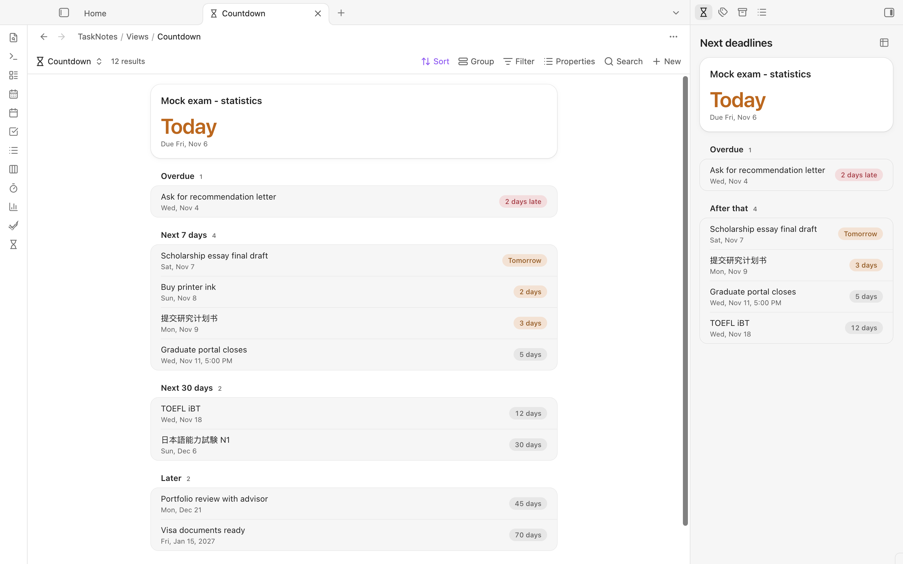
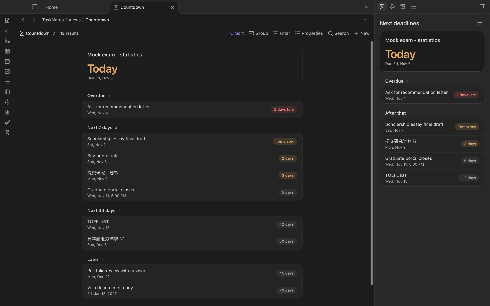

# TaskNotes Countdown

Days left to your [TaskNotes](https://github.com/callumalpass/tasknotes) due dates: exams, application deadlines, anything with a `due` date.



- **Countdown view for Bases.** In any `.base`, switch the view to *Countdown*. The nearest deadline is shown large; the rest is grouped into Overdue, Today, Next 7 days, Next 30 days and Later. If the base has its own *Group by*, those groups are kept.
- **Next deadlines in the sidebar.** Open it from the hourglass in the ribbon or the command *Open next deadlines*. Limit it to tags such as `exam` and `application` in the settings.
- **Read-only.** The plugin never changes a task. Clicking a row opens the task note; Cmd/Ctrl-click opens it in a new tab.
- **Follows TaskNotes.** Completed statuses, the archive tag, the task tag or property, and renamed `due`/`status` fields come from your TaskNotes settings.
- **Light at startup.** Nothing is read while Obsidian starts. Tasks are read after TaskNotes reports its cache is ready, then only when a task changes.
- English, Chinese and Japanese, following Obsidian's language.



## Getting started

1. Install and enable TaskNotes 4 and turn on the core **Bases** plugin.
2. Run **Create or open countdown base**. It writes `Countdown.base` into the folder TaskNotes keeps its views in (by default `TaskNotes/Views`) and opens it. An existing file is opened, never overwritten.
3. Or add a *Countdown* view to any base you already have. View options: date property, status property, how many days count as close, and whether to show completed tasks.

## Settings

| Setting | Default | |
|---|---|---|
| Only these tags | empty (every task) | Sidebar only. Comma-separated; nested tags match (`exam` matches `exam/toefl`). |
| Tasks in the sidebar | 6 | |
| Highlight within days | 3 | Closer deadlines turn orange. Bases views have their own option. |

## How it reads TaskNotes

The sidebar uses the [TaskNotes runtime API](https://github.com/callumalpass/tasknotes/blob/main/docs/javascript-api.md) (`apiVersion` 1): `tasks.list`, `catalog.statuses`, `settings.snapshot`, and the task and lifecycle events. It checks the version and capabilities first and shows a notice instead of failing when TaskNotes is off or too old. The Bases view reads note properties through Bases itself, so it keeps working even while TaskNotes is disabled.

## Privacy

No network requests. Nothing leaves your vault. The only file the plugin ever writes is `Countdown.base`, and only when you run the command.

## Development

```bash
npm install
npm run build   # styles + type check + bundle
npm test        # date logic, labels, starter base
npm run lint    # Obsidian community directory rules, warnings fail
```

A demo vault with only TaskNotes and this plugin, and made-up tasks dated relative to today:

```bash
demo/reset.sh            # rebuild ~/Obsidian/TaskNotes-Countdown-Demo from scratch
demo/open.sh --lang en   # open it in a separate Obsidian instance (en, zh or ja)
demo/shots.sh docs/screenshots
```

`reset.sh` downloads TaskNotes 4.16.1 from its GitHub release on first run and only deletes a folder that carries its `.tnc-demo` marker.

## License

MIT
