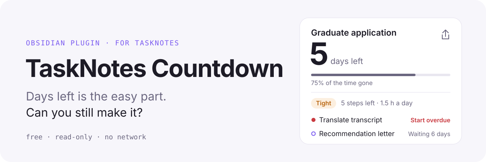
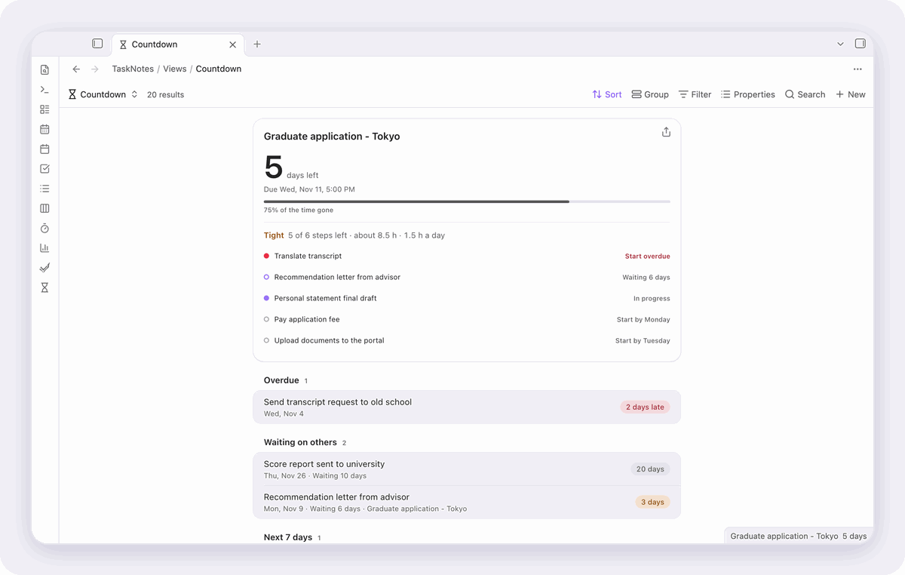
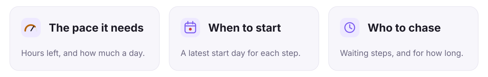

<p align="right"><a href="README_zh.md">中文</a></p>

<picture>
  <source media="(prefers-color-scheme: dark)" srcset="assets/readme/hero-dark.svg">
  
</picture>

<p align="center"><a href="https://community.obsidian.md/plugins/tasknotes-countdown"><b>Install from Obsidian</b></a></p>

<picture>
  <source media="(prefers-color-scheme: dark)" srcset="assets/readme/demo-dark.gif">
  
</picture>

<picture>
  <source media="(prefers-color-scheme: dark)" srcset="assets/readme/cards-dark.svg">
  
</picture>

## Start in three steps

1. Install **TaskNotes Countdown** from *Settings → Community plugins → Browse* and enable it.
2. Turn on the core **Bases** plugin and run **Create or open countdown base**.
3. Give a deadline's steps a `projects` link to it and a time estimate in TaskNotes.

**Needs** [TaskNotes](https://github.com/callumalpass/tasknotes) 4 and Obsidian 1.12.2+, desktop or mobile. **Costs** nothing: no account, no network, and it never changes a task.

## Everything else

<details>
<summary><b>Every feature</b></summary>

<picture>
  <source media="(prefers-color-scheme: dark)" srcset="docs/screenshots/countdown-dark.png">
  
</picture>

- **Work left and the pace it needs.** Under the nearest deadline: steps left, hours left and how much a day that means. It turns orange (*Tight*) when the pace is more than the hours you said you can give.
- **When each step must start.** Every open subtask gets a latest start day: its due date, minus a buffer, minus the days its remaining work needs. Steps that should start today, or should already have started, are marked.
- **Waiting on others.** Steps marked as waiting (a context, tag or status; `waiting` by default), such as a recommendation letter, get their own list with how many days you have been waiting, so you know whom to chase.
- **How much time is gone.** A thin bar from the start (the scheduled date, or the day the task was created) to the deadline: *71% of the time gone*.
- **Finished early.** Deadlines you closed in the last three days stay in the sidebar for a moment: *3 days early*, *On the day*, or *2 days late*.
- **Share as an image.** The share button on the nearest deadline (or the command *Share next deadline as image*) draws a 3:4 card in your theme's colours and copies it, ready for a chat or a post. Where the clipboard takes no images, as on phones, it is saved as an attachment instead.
- **Visible without opening anything.** The next deadline sits in the status bar. Put a `tasknotes-countdown` block in your daily note template and every daily note shows the nearest few.
- **Countdown view for Bases.** In any `.base`, switch the view to *Countdown*. The nearest deadline is large with its plan; subtasks fold into their deadline; the rest is grouped into Overdue, Waiting on others, Today, Next 7 days, Next 30 days and Later. A base's own *Group by* is kept.
- **Next deadlines in the sidebar.** Open it from the hourglass in the ribbon or the command *Open next deadlines*. Limit it to tags such as `exam` and `application`; subtasks come along with their deadline.
- **Read-only, and nothing to lose.** The plugin never changes a task and stores nothing of its own beyond settings. Clicking opens the task note.
- **Follows TaskNotes.** Completed statuses, the default status, the archive tag, the task tag or property, and renamed fields come from your TaskNotes settings.
- **Light at startup.** Nothing is read while Obsidian starts. Tasks are read once after TaskNotes reports its cache is ready, then once per change, and every view draws from that one read.

</details>

<details>
<summary><b>Getting started in detail</b></summary>

1. Install and enable TaskNotes 4 and turn on the core **Bases** plugin.
2. Run **Create or open countdown base**. It writes `Countdown.base` into the folder TaskNotes keeps its views in (by default `TaskNotes/Views`) and opens it. An existing file is opened, never overwritten.
3. Or add a *Countdown* view to any base you already have. View options: date property, status property, how many days count as close, and whether to show completed tasks.

**How subtasks are found.** A task is a step of a deadline when its `projects` link to that deadline's note, which is how TaskNotes records subtasks. Give steps a time estimate in TaskNotes to get hours and start days; without estimates you still see the steps and the countdown.

**In a daily note:**

````markdown
```tasknotes-countdown
limit: 3
tags: exam, application
```
````

Both lines are optional; without them the block uses the sidebar's tags and shows three deadlines.

</details>

<details>
<summary><b>Settings</b></summary>

| Setting | Default | |
|---|---|---|
| Only these tags | empty (every task) | Sidebar only. Comma-separated; nested tags match (`exam` matches `exam/toefl`). |
| Tasks in the sidebar | 6 | |
| Highlight within days | 3 | Closer deadlines turn orange. Bases views have their own option. |
| Show the next deadline in the status bar | on | Click it to open the sidebar. |
| Hours a day for deadlines | 3 | Used for the pace and the start days. |
| Buffer days | 1 | Each step is planned to finish this many days early. |
| Waiting marker | `waiting` | A context, tag or status that means you are waiting on someone. |

</details>

<details>
<summary><b>Privacy and what the plugin touches</b></summary>

No network requests. Nothing leaves your vault. The plugin writes only two kinds of file, and only when you ask: `Countdown.base` when you run that command, and a share image when the clipboard cannot take it.

**Clipboard:** only written, never read, and only when you press share.

</details>

<details>
<summary><b>How it reads TaskNotes</b></summary>

The sidebar, status bar, note blocks and plans use the [TaskNotes runtime API](https://github.com/callumalpass/tasknotes/blob/main/docs/javascript-api.md) (`apiVersion` 1): `tasks.list` (one call per change, shared by every view), `catalog.statuses`, `settings.snapshot`, and the task and lifecycle events. Subtask links are resolved with Obsidian's link resolver. It checks the version and capabilities first and shows a notice instead of failing when TaskNotes is off or too old. The Bases view reads note properties through Bases itself, so its countdown keeps working while TaskNotes is disabled; plans and waiting lists need TaskNotes.

</details>

<details>
<summary><b>Language and themes</b></summary>

English, Chinese and Japanese, following Obsidian's language. Colours, radii and spacing come from your theme's variables; light and dark mode both work, and the share image uses your theme's colours.

</details>

<details>
<summary><b>Development and verifying a release</b></summary>

```bash
npm install
npm run build   # styles + type check + bundle
npm test        # dates, plans, start days, waiting, time gone, finished early, card text, labels, note block, starter base
npm run lint    # Obsidian community directory rules, warnings fail
```

A demo vault with only TaskNotes and this plugin, and made-up tasks dated relative to today:

```bash
demo/reset.sh            # rebuild ~/Obsidian/TaskNotes-Countdown-Demo from scratch
demo/open.sh --lang en   # open it in a separate Obsidian instance (en, zh or ja)
demo/shots.sh docs/screenshots
assets/readme/source/record.sh   # the README art and demo GIFs
```

`reset.sh` downloads TaskNotes 4.16.1 from its GitHub release on first run and only deletes a folder that carries its `.tnc-demo` marker.

Releases are built by GitHub Actions from a version tag, with build provenance attested. To check a download:

```bash
gh attestation verify main.js --owner Rexxall
```

Changes are listed in [CHANGELOG.md](CHANGELOG.md).

</details>

MIT License
