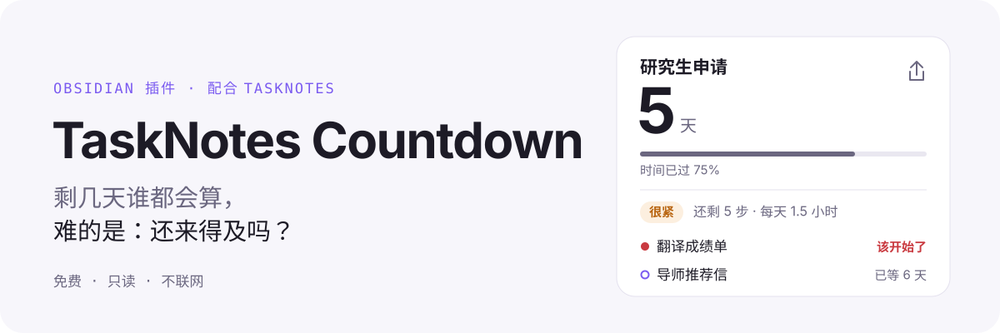
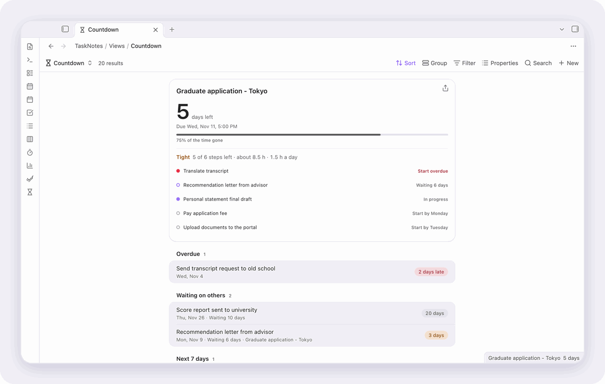
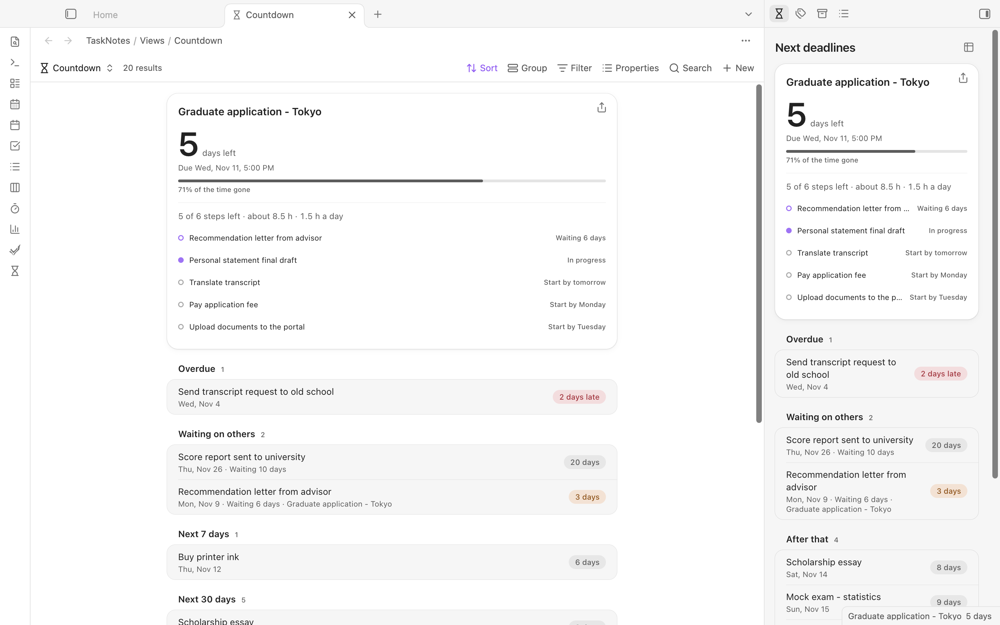

<p align="right"><a href="README.md">English</a></p>

<picture>
  <source media="(prefers-color-scheme: dark)" srcset="assets/readme/hero-zh-dark.svg">
  
</picture>

<p align="center"><a href="https://community.obsidian.md/plugins/tasknotes-countdown"><b>在 Obsidian 里安装</b></a></p>

<picture>
  <source media="(prefers-color-scheme: dark)" srcset="assets/readme/demo-dark.gif">
  
</picture>

<picture>
  <source media="(prefers-color-scheme: dark)" srcset="assets/readme/cards-zh-dark.svg">
  
</picture>

## 三步上手

1. 在“设置 → 第三方插件 → 浏览”里搜索 **TaskNotes Countdown**，安装并启用。
2. 打开核心插件 **Bases**，在命令面板运行“新建或打开倒计时视图”。
3. 在 TaskNotes 里给每个步骤的 `projects` 链接到它的截止任务，再填上预估用时。

**需要** [TaskNotes](https://github.com/callumalpass/tasknotes) 4 和 Obsidian 1.12.2 或更新，电脑和手机都能用。**费用** 不要钱：不用注册，不联网，从不改动任务。

## 其余内容

<details>
<summary><b>全部功能</b></summary>

<picture>
  <source media="(prefers-color-scheme: dark)" srcset="docs/screenshots/countdown-dark.png">
  
</picture>

- **还剩多少活、每天要做多久。** 最近的截止下面写着还剩几步、几小时、每天要几小时。超过你说的每天可用时间，会变橙色并标“很紧”。
- **每一步最晚哪天开始。** 每个没做完的子任务都有最晚开始日：它的截止日，减去缓冲天数，再减去剩下的活要用的天数。今天该开始的、早该开始的，都会标出来。
- **在等别人的事。** 标成等待的步骤（上下文、标签或状态，默认 `waiting`），比如推荐信，单独列出来，并写着已经等了几天，知道该催谁。
- **时间过去了多少。** 一条细进度条，从开始（计划日期，或任务创建那天）到截止：“时间已过 71%”。
- **提前完成。** 最近三天完成的截止会在侧栏留一会儿：“提前 3 天”“当天完成”或“晚 2 天”。
- **分享成图片。** 最近截止上的分享按钮（或命令“把最近的截止生成分享图”）用你主题的颜色画一张 3:4 卡片并复制，可以直接发聊天或发帖。剪贴板不收图片的地方（比如手机）会改存成附件。
- **不用打开也看得到。** 最近的截止显示在状态栏。在日记模板里放一个 `tasknotes-countdown` 代码块，每篇日记都会显示最近几项。
- **Bases 的倒计时视图。** 在任意 `.base` 里把视图切成“倒计时”。最近的截止放大显示并附计划；子任务收进它的截止里；其余按已过期、等别人、今天、7 天内、30 天内、以后分组。Base 自己的“分组”设置会保留。
- **侧栏里的最近截止。** 点左侧功能区的沙漏或运行命令“打开最近截止”。可以只看 `exam`、`application` 这样的标签；子任务跟着它的截止一起显示。
- **只读，不会弄丢东西。** 插件从不改动任务，除了设置不存任何东西。点一下就打开任务笔记。
- **跟着 TaskNotes 的设置走。** 完成状态、默认状态、归档标签、任务标签或属性、改过名的字段，都从 TaskNotes 的设置里读。
- **启动不拖慢。** Obsidian 启动时什么都不读。等 TaskNotes 说缓存好了读一次，之后每次改动再读一次，所有视图共用这一份。

</details>

<details>
<summary><b>上手细节</b></summary>

1. 安装并启用 TaskNotes 4，打开核心插件 **Bases**。
2. 运行“新建或打开倒计时视图”。它会在 TaskNotes 放视图的文件夹（默认 `TaskNotes/Views`）里写一个 `Countdown.base` 并打开。已有的文件只会打开，不会覆盖。
3. 也可以在任何已有的 Base 里加一个“倒计时”视图。视图选项：日期属性、状态属性、几天内算临近、是否显示已完成。

**子任务怎么认。** 一个任务的 `projects` 链接到某个截止任务的笔记，它就是这个截止的一步，这也是 TaskNotes 记录子任务的方式。在 TaskNotes 里给步骤填预估用时，就能算出小时数和开始日；不填也能看到步骤和倒计时。

**放进日记：**

````markdown
```tasknotes-countdown
limit: 3
tags: exam, application
```
````

两行都可以不写；不写时用侧栏的标签，显示三项。

</details>

<details>
<summary><b>设置</b></summary>

| 设置 | 默认 | |
|---|---|---|
| 只看这些标签 | 空（全部任务） | 只影响侧栏。用逗号分隔；嵌套标签也算（`exam` 能匹配 `exam/toefl`）。 |
| 侧栏显示几件 | 6 | |
| 几天内标为紧急 | 3 | 更近的截止变橙色。Bases 视图有自己的选项。 |
| 在状态栏显示最近的截止日 | 开 | 点它打开侧栏。 |
| 每天能投入几小时 | 3 | 用来算每天要做多久和开始日。 |
| 留出缓冲天数 | 1 | 每一步按提前这么多天完成来排。 |
| “等别人”标记 | `waiting` | 表示“在等别人”的上下文、标签或状态。 |

</details>

<details>
<summary><b>隐私和插件会碰什么</b></summary>

不发任何网络请求，什么都不离开你的库。插件只在你要求时写两种文件：运行那条命令时写 `Countdown.base`，剪贴板不收图片时存一张分享图。

**剪贴板：** 只写不读，而且只在你点分享时写。

</details>

<details>
<summary><b>怎么读 TaskNotes 的数据</b></summary>

侧栏、状态栏、笔记代码块和计划用的是 [TaskNotes 运行时 API](https://github.com/callumalpass/tasknotes/blob/main/docs/javascript-api.md)（`apiVersion` 1）：`tasks.list`（每次改动调用一次，所有视图共用）、`catalog.statuses`、`settings.snapshot`，以及任务和生命周期事件。子任务链接用 Obsidian 的链接解析。先检查版本和能力，TaskNotes 没开或太旧时给出提示，而不是报错。Bases 视图通过 Bases 自己读笔记属性，所以 TaskNotes 关掉时倒计时照样能用；计划和等待列表需要 TaskNotes。

</details>

<details>
<summary><b>语言和主题</b></summary>

英文、中文、日文，跟着 Obsidian 的语言切换。颜色、圆角和间距都取自你主题的变量；浅色深色都能用，分享图也用你主题的颜色。

</details>

<details>
<summary><b>开发和核验发布文件</b></summary>

```bash
npm install
npm run build   # 样式 + 类型检查 + 打包
npm test        # 日期、计划、开始日、等待、时间进度、提前完成、卡片文字、标签、笔记代码块、初始 Base
npm run lint    # Obsidian 社区目录规则，有警告就失败
```

只装了 TaskNotes 和本插件的演示库，任务是编的，日期相对今天生成：

```bash
demo/reset.sh            # 从零重建 ~/Obsidian/TaskNotes-Countdown-Demo
demo/open.sh --lang zh   # 用单独的 Obsidian 实例打开（en、zh 或 ja）
demo/shots.sh docs/screenshots
assets/readme/source/record.sh   # 重做 README 的配图和动图
```

`reset.sh` 第一次运行时从 GitHub release 下载 TaskNotes 4.16.1，只会删除带 `.tnc-demo` 标记的文件夹。

发布文件由 GitHub Actions 按版本标签构建，并附构建来源证明。核验下载的文件：

```bash
gh attestation verify main.js --owner Rexxall
```

更新记录见 [CHANGELOG.md](CHANGELOG.md)。

</details>

MIT 许可证
